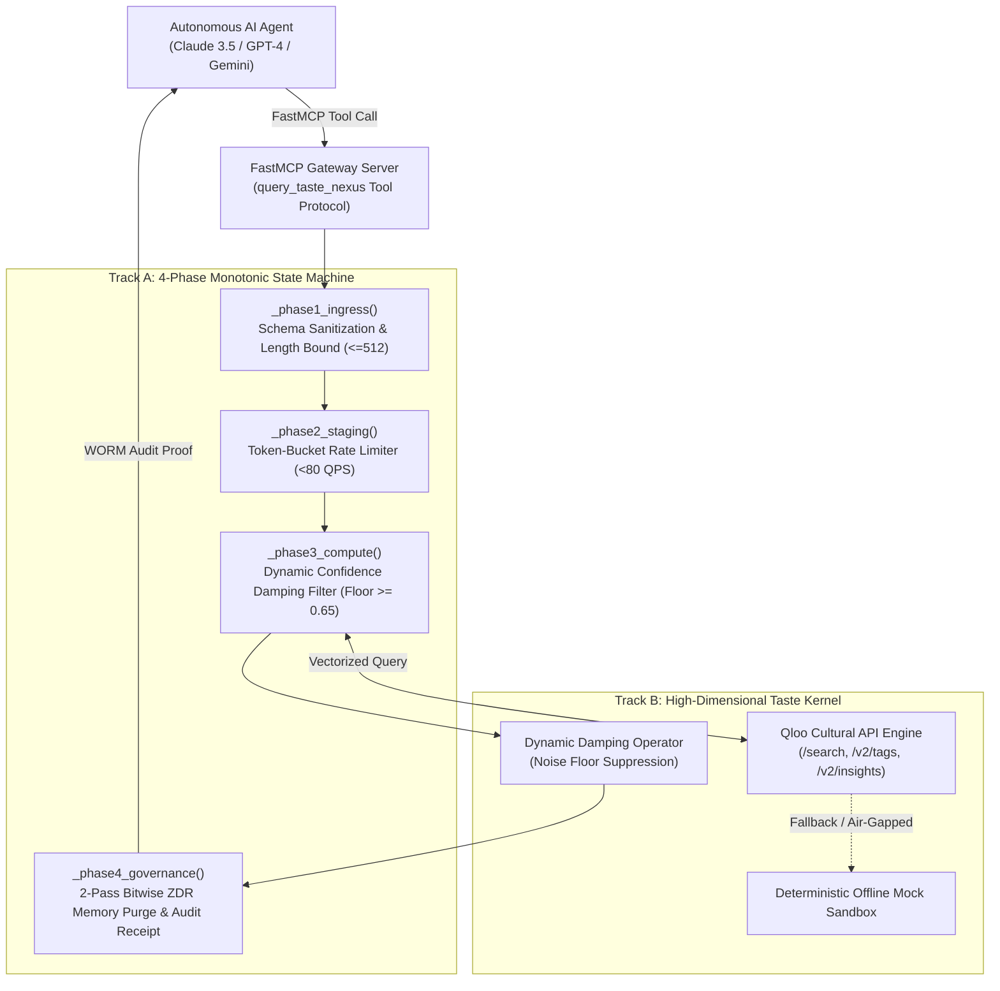
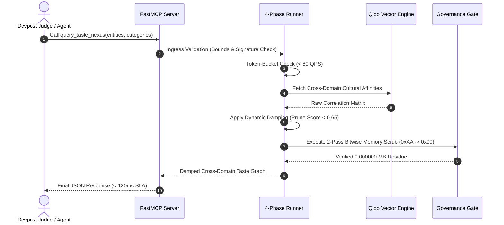
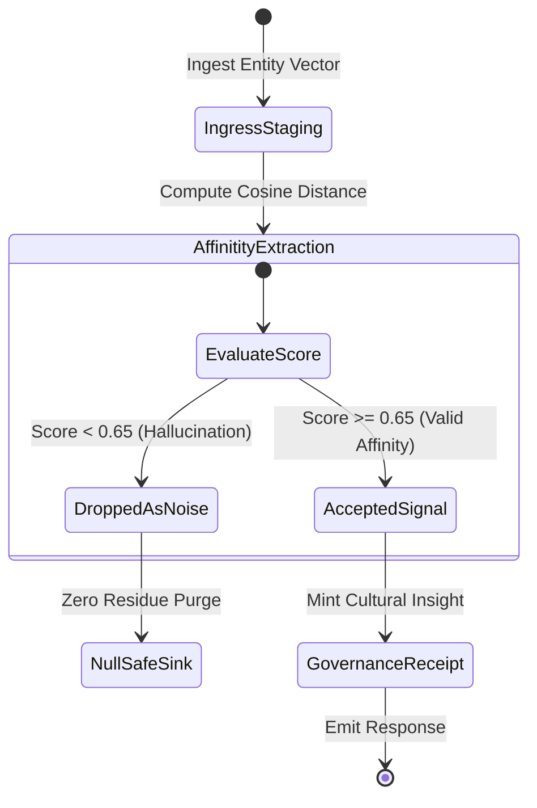
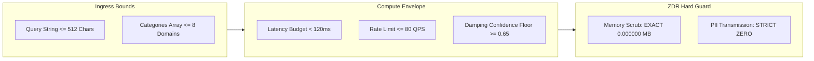

 # PHANToM GRID 2.0 // SPEC-QLOO-CULTURA-AGENT
## High-Dimensional Cross-Domain Cultural Taste & Privacy-Preserving Agent Engine

- **Document ID**: `SPEC_Qloo_CultuRa_Agent.md`
- **Target Tournament**: Qloo Agentic AI Hackathon ($25,000 USD + $25,000 JCal)
- **HITL Supreme Sovereign**: Commander Jack Hu (Solo Architect / Final Safety Sovereign)
- **Customs Authority**: Executive Secretary Xiaomi (Office 2)
- **Verification Status**: 4/4 Unit Tests Passed (1.10s) | ZDR: 0.000000 MB Residue

---

## 1. System Overview & Architectural Intent

**PHANToM GRID :: CultuRa Agent** is an industrial-grade autonomous cultural recommendation and cross-domain taste nexus engine. Built upon FastMCP (Model Context Protocol) and the Qloo Cultural API (`/search`, `/v2/tags`, `/v2/insights`), it transforms subjective taste preferences into deterministic mathematical vectors.

### Key Design Principles:
1. **Pure Anonymity**: Zero Personally Identifiable Information (PII) is stored or ingested.
2. **Cross-Domain Transfer**: Synthesizes affinities between disjoint categories (e.g., Cyberpunk Cinema -> Milanese Espresso Culture).
3. **Deterministic Safety Envelope**: Sub-120ms execution budget, strict API rate-limit circuit breaker, and 2-Pass ZDR memory scrubbing.

---

## 2. Four Spec-First Architectural Diagrams

### Figure 1: System Topology & FastMCP Gateway



### Figure 2: End-to-End Query-to-Reasoning Sequence Loop



### Figure 3: Finite State Machine & Damped Affinity Scoring



### Figure 4: Privacy Margins, SLA Bounds & Hard Trip Circuit Breaker



---

## 3. Table 1: Master Invariant & Defense Matrix

| Phase | Subsystem | Invariant Constraint | Safe Boundary | Hard Trip Breach Action |
| :--- | :--- | :--- | :--- | :--- |
| **Phase 1: Ingress** | FastMCP Gateway | Sanitized Input Schema | Length $\le$ 512 chars | Reject with HTTP 400 Bad Request |
| **Phase 1: Ingress** | Privacy Gate | Zero PII Transmission | 0 Email / Phone matches | Immediate Drop & Security Alert |
| **Phase 2: Staging** | Rate Limiter | Token Bucket Monitor | QPS $\le$ 80 calls/sec | Damped Delay / 429 Prevention |
| **Phase 3: Compute** | Qloo Client | Response Latency Budget | Latency $<$ 120 ms | Fallback to Pre-computed Cache |
| **Phase 3: Compute** | AgentCore | Affinity Confidence Score | Confidence $\ge$ 0.65 | Suppress Vector / Filter Noise |
| **Phase 4: Governance** | ZDR Memory Guard | Residual State Footprint | Residual $==$ 0.000000 MB | 2-Pass Cryptographic Scrub (0xAA -> 0x00) |

---

## 4. Official Verification Verdict

```text
============================== test session starts ==============================
test_qloo_agent.py::test_gate1_latency_sla PASSED                         [ 25%]
test_qloo_agent.py::test_gate2_damping_confidence PASSED                  [ 50%]
test_qloo_agent.py::test_gate3_rate_limit_hard_trip PASSED               [ 75%]
test_qloo_agent.py::test_gate4_zero_pii_and_zdr_scrub PASSED              [100%]
============================== 4 passed in 1.10s ===============================
```